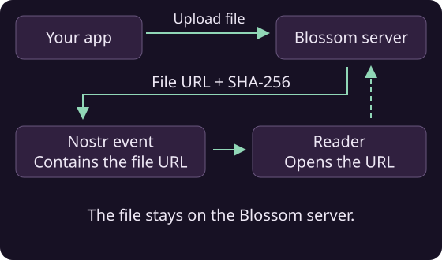

# Blossom - media storage

Blossom stores images and other files for your Nostr app. Upload a file, then use its URL in an event. Each file is identified by its SHA-256 hash.



## Upload and manage files

Add a server to a `BlossomPool`. The pool uses your signer to authorize uploads and deletions:

```java
BlossomPool blossom = new BlossomPool(signer);
blossom.ensureEndpoint(new BlossomEndpoint("https://blossom.example.com"));

// Upload a file
BlobDescriptor blob = blossom.upload(ByteBuffer.wrap(imageBytes)).await();
blob.getUrl();
blob.getSha256();
blob.getSize();

// Download or check whether the file exists
ByteBuffer back = blossom.get(blob.getSha256()).await();
boolean there = blossom.exists(blob.getSha256()).await();

// List uploads and delete your file
List<BlobDescriptor> mine = blossom.list(myPubkey).await();
blossom.delete(blob.getSha256()).await();
```

Close the pool when you no longer need it.

!!! tip "Use the uploaded file in an event"
    Put `blob.getUrl()` in your event's content or media tags. Upload overloads also let you supply a file name and MIME type.

!!! note "File verification"
    Verification is enabled by default. Uploads check the returned hash and size; full downloads check the file against its hash. A mismatch fails the operation. Check server-provided URLs before displaying or opening them in your app.

!!! warning "Partial downloads"
    A byte-range download cannot pass the default full-file hash check. If you need partial downloads, disable that check with `endpoint.setVerifyBlobs(false)` and verify the partial data in your app.

## Mirror an existing blob

Ask a configured server to copy a file from a public URL:

```java
BlobDescriptor mirrored = blossom.mirror(
    "https://media.example.com/known-blob",
    expectedSha256).await();
```

Pass the file's known hash as `expectedSha256`. The pool authorizes the request and checks that the returned descriptor matches that hash. If one server fails, it tries the others.

!!! tip "Mirroring without a known hash"
    Use `mirror(url)` when you only have the URL. This sends an unauthenticated request, so it requires a server that allows it.

## Upload optimized media

```java
BlobDescriptor optimized = blossom.uploadMedia(imageBytes, "image/png").await();
```

The pool asks its servers to optimize the media. If none supports the operation, it uploads the original file.

!!! tip "Use the optimized result"
    Use the URL and hash from the returned descriptor. Optimization can change the file's contents, size and format.

After a successful optimization, the pool asks the other servers to mirror the result in the background.

!!! note "Additional copies"
    The upload completes before those copies are confirmed. Check them separately if your app needs the file stored on multiple servers.
