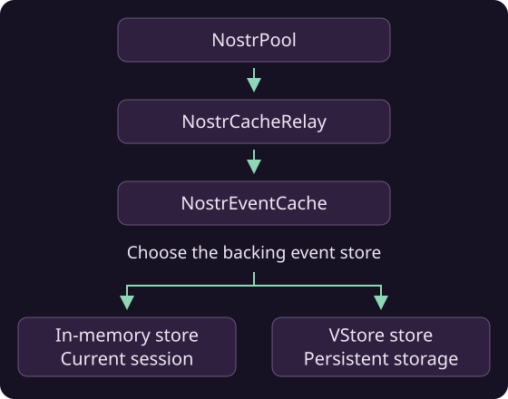

# Cache events locally

A cache lets your app reuse events it has already received. The `NostrEventCache` constructor accepts an [event store](event-stores.md) to hold the cached events. Choose a store to control how and where those events are saved.



## Create a cache

Choose the event store and configure the cache for your application:

```java
NostrEventStore store = new NostrInMemoryEventStore(1000);
NostrEventCache cache = new NostrEventCache(store);
cache.setTtl(Duration.ofMinutes(10)).await();
cache.setReplaceableTtl(Duration.ofSeconds(30)).await();

cache.put(event.getId(), event).await();
SignedNostrEvent saved = cache.get(event.getId()).await();
List<SignedNostrEvent> notes = cache.query(
    List.of(new NostrFilter().withKind(1).limit(20))).await();
```

!!! tip
    For a persistent cache, pass a [VStore Event Store](event-stores.md#vstore-event-store).

## Use cached events in your Nostr pool

Add a cache relay to let normal pool reads use the cache:

```java
NostrEventStore store = new NostrInMemoryEventStore(1000);
NostrEventCache cache = new NostrEventCache(store);
NostrCacheRelay cacheRelay = new NostrCacheRelay(cache);
NostrPool pool = new NostrPool();
pool.addRelay(cacheRelay).await();
pool.ensureRelay("wss://relay.ngengine.org").await();
```
