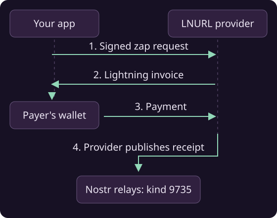

# Tip with zaps

To tip a note or profile, first request a Lightning invoice from the recipient's LNURL-pay provider. Include a signed zap request so the payment can be associated with the Nostr event or account. After payment, the provider publishes a kind-9735 receipt to the relays named in that request.



## Zapping an event

```java
// 1. Build/sign the kind-9734 request and send it to the recipient's
//    provider while requesting invoices (one task per zap target).
List<AsyncTask<ZapInvoice>> invoices = Nip57.getZapInvoices(
    pool, payerSigner, payerMetadata, eventToZap, 21_000, "great post!");

ZapInvoice inv = invoices.get(0).await();
if (inv == null) throw new IllegalStateException("recipient has no payment address");

// 2. pay the Lightning invoice with your wallet
PayResponse payment = wallet.payInvoice(inv.getInvoice(), null, null).await();

// 3. Do not publish inv.getZapRequest() yourself. The LNURL-pay provider
//    publishes the kind-9735 receipt after it observes payment.
```

Amounts are in millisatoshis.

!!! tip "Tip a profile or Lightning address"
    To tip a profile, use the `getZapInvoices` overload that accepts a public key. If you already know the Lightning address, use the overload that accepts an `LnUrl`. A target without a usable Lightning address raises `MalformedZapTargetException`.

## Reading zaps

```java
// zap receipts (kind 9735) for an event, a recipient, a sender...
List<SignedNostrEvent> receipts =
    Nip57.getZaps(pool, eventToZap, null, null, null, null).await();
```

When displaying received zaps, validate the receipt against the invoice, request and provider you expect:

```java
ZapReceipt receipt = Nip57.parseAndValidateZapReceipt(
    receiptEvent,
    expectedInvoice,   // the ZapInvoice you paid, or null to skip
    expectedProvider,  // trusted provider pubkey; may come from expectedInvoice
    expectedRequest,   // the zap request you signed, or null
    expectedPreimage,  // payment preimage, or null
    expectedLnUrl,     // recipient Lightning address, or null
    expectedSender)    // who paid, or null
    .await();
```

Supply the provider's public key through `expectedInvoice` or `expectedProvider`. Validation requires this key; the other expectations can be `null` when unavailable.

!!! warning "Use a trusted provider key"
    Obtain the provider key independently of the receipt you are checking. Taking it from an unverified receipt would let the receipt choose its own trusted signer.

Validation checks both signatures and matches the receipt against the payment details you supply. Pass the invoice and request when you have them.

Read the sender and recipient with `getSender()` and `getRecipient()`, and the amount with `receipt.getZapRequestEvent().getAmountMsats()`.

!!! tip "Save the original request JSON"
    When saving or forwarding a `ZapInvoice`, preserve `getZapRequestJson()` exactly. The invoice uses a hash of that JSON, so reformatting it can break validation. The serialized invoice includes it as `request_json`.
