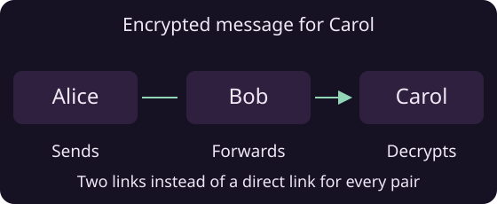

# Multi-Hop Routing

<a class="doc-run-button" href="../demos.html#game">Run routed game</a>

Multi-hop routing lets peers communicate through other participants in the room. Alice can send to Carol through Bob, even when Alice and Carol have no direct connection.



Use the same room API to address the destination:

```java
room.send(peer, ByteBuffer.wrap(message));
```

## How routing works

Peers share signed information about their connections. The room uses links confirmed by both ends to build routes and updates them as peers join or leave.

A working direct WebRTC connection is preferred. Otherwise, the room chooses between a route through other peers and an available TURN path based on their cost.

!!! note "Available paths"
    Peers need a working path to exchange messages. A new peer may be discovered before its route is ready. Handle failed sends when a participant is unreachable.

## Keep fewer direct connections

Each peer keeps up to 16 direct neighbors by default:

```java
RTCSettings settings = RTCSettings.getDefault("my-app", "chat-v1")
    .withMaxDirectPeers(8);
```

The supported range is two to 64. Fewer direct connections mean more forwarding; more direct connections give the room additional paths.

!!! tip "Room size"
    The direct-peer budget limits connections, not room membership. Other participants remain reachable through the room's routes.

## Encrypted forwarding

Route setup uses layers of encryption. Each forwarding peer opens its layer to find the next hop. Application data stays encrypted for its destination.

In the diagram, Bob forwards the packet while Carol decrypts the message.

!!! warning "Privacy"
    Forwarding peers can observe adjacent connections, timing and traffic volume. Multi-hop routing protects the message contents from them; it does not guarantee anonymity.

## Broadcast to the room

```java
room.broadcast(ByteBuffer.wrap(announcement));
```

Broadcast distributes an update through the room's confirmed connections. Receivers verify the sender's session signature before accepting or forwarding it.

!!! note "Group messages"
    Broadcast content is intended for the whole room. Use a send to one peer for destination-only encryption. Collect replies if your app needs confirmation from every participant.

Read the [NIP-DC specification](https://github.com/NostrGameEngine/nostr4j/blob/master/NIP-DC.md) for more information about the internal workings of the protocol.
