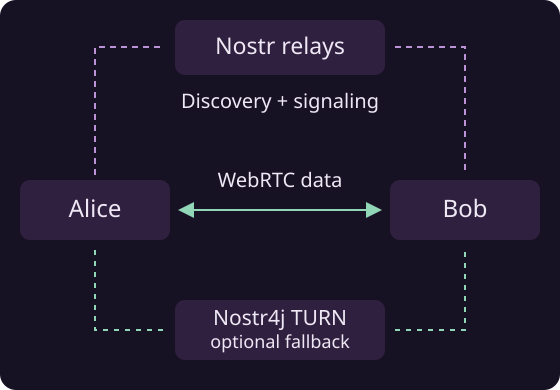
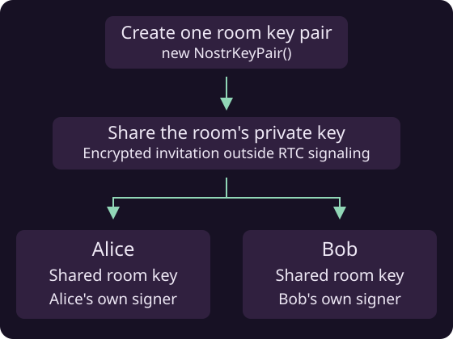

# How RTC connections work

Nostr4j uses Nostr relays to help peers find each other and set up connections. Application data then travels over WebRTC, with routing and an optional fallback when a direct path is unavailable.

For a simple two-peer Java I/O connection, start with [Simple P2P streams](simple-rtc-connection.md). Use `NostrRTCRoom` when you need multiple participants, asynchronous messages or named channels.



## Create or join a room

Create a room by generating a normal key pair once:

```java
NostrKeyPair roomKeyPair = new NostrKeyPair();
String roomInvitation = roomKeyPair.getPrivateKey().asBech32();
```

Share `roomInvitation` out of band: through an authenticated, encrypted invitation channel provided by your app. Room-key distribution happens outside RTC signaling.

Each invited participant reconstructs the same room key pair from that invitation:

```java
NostrKeyPair roomKeyPair = new NostrKeyPair(
    NostrPrivateKey.fromBech32(sharedRoomNsec));
```

Here, `sharedRoomNsec` is the received invitation. Each participant also uses their own identity signer. Generating a different room key on each device would create different rooms.



| Value | Purpose |
|---|---|
| Participant signer | Identifies this peer |
| Shared room key | Identifies the room and proves membership |
| Application ID | Identifies your app |
| Protocol ID | Identifies the message format your app uses |
| Signaling relays | Let participants discover each other and exchange connection details |

Put the application ID, protocol ID and relay URLs in `RTCSettings`. Supply the signer and room key when creating the local peer and room. Each running instance also gets a session ID automatically.

!!! tip "Room access"
    The invitation contains the room's private key. Share it only with participants allowed to join. Their personal identity keys remain separate.

## Discover and connect

Starting the room announces your peer through its Nostr relays. Peers discover each other and exchange the information needed to establish WebRTC connections.

Register listeners before starting. They tell your app when a peer becomes available and when messages arrive.

!!! note "Discovery takes time"
    A discovered peer may still be establishing its transport. Handle the tasks returned by send operations so your app can react to a failed delivery.

## Exchange messages

Send a byte buffer to one participant or broadcast it to the room:

```java
room.send(peer, ByteBuffer.wrap(message));
room.broadcast(ByteBuffer.wrap(announcement));
```

Your app chooses the data format, such as JSON or a game-state update. The receiving listener gets the sender, channel and payload. Named channels let you separate different kinds of traffic on the same connection.

The [room guide](rtc-rooms.md) puts setup, listeners and sending together.

## Reach peers through the room

The room automatically routes messages through other participants when there is no working direct connection to the destination and an alternative path is available. Your app keeps using the same `send` call; route selection and updates are handled by the library.


[Multi-hop routing](onion-routing.md) and a configured [TURN service](turn-server.md) provide alternative paths. The library updates paths as connectivity changes.

!!! tip "End-to-end encryption"
    Messages addressed to one peer remain encrypted end to end, whether sent directly, through a TURN server or through other peers. Only the destination peer can decrypt the payload; intermediaries forward encrypted data. Broadcast messages are intended for all room members.

For the signaling and packet formats, see the [NIP-DC specification](https://github.com/NostrGameEngine/nostr4j/blob/master/NIP-DC.md).
