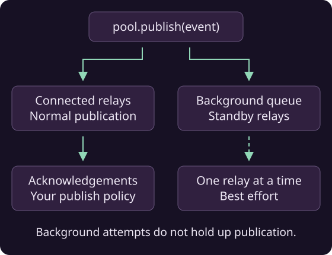

# Background propagation

Relays registered in the pool but disconnected because they are outside the [connection budget](relay-hints.md) can still receive public events through background propagation. The pool connects to them one at a time to propagate events on a best-effort basis, alongside normal pool activity.



Setting a positive budget enables this behavior automatically:

```java
NostrPool pool = new NostrPool();
pool.setConnectionBudget(2);
pool.setBestEffortPropagationQueueCapacity(256);
pool.setBestEffortPropagationInterval(Duration.ofMillis(250));

pool.registerRelay(new NostrRelay("wss://relay.ngengine.org"));
pool.registerRelay(new NostrRelay("wss://relay2.ngengine.org"));
pool.registerRelay(new NostrRelay("wss://nostr.rblb.it"));
```

Publish as usual with `pool.publish(signed)`. The pool sends to active relays and queues deliveries to the standby relays.

Use `getPendingBestEffortPropagations()` to check how many deliveries remain, including the current attempt.

!!! note "Publication result"
    A successful `publish` follows your acknowledgement policy for the immediate sends. Background deliveries may still be pending.

!!! tip "Disable background propagation"
    Call `pool.setBestEffortPropagation(false)` to turn it off. Pass `true` to enable it again with a positive connection budget.

!!! note "Best-effort background propagation"
    Background propagation is best effort: the pool tries to publish to as many standby relays as possible without holding up normal publication to connected relays. Background attempts have a time limit, a full queue drops its oldest unstarted delivery, and closing the pool clears pending background work.
