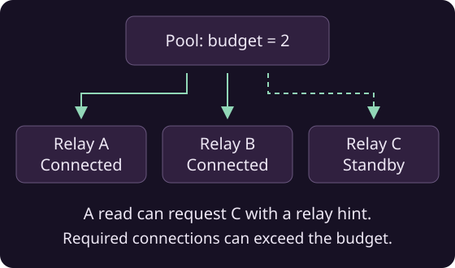

# Relay hints and connection budgets

A connection budget controls how many relays the pool keeps connected. Relay hints let you choose which relays to use for a particular read.



## Set a connection budget

```java
NostrPool pool = new NostrPool();
pool.setConnectionBudget(2);

NostrRelay preferred = new NostrRelay("wss://relay.ngengine.org");
preferred.setConnectionPriority(20);
pool.registerRelay(preferred);
pool.registerRelay(new NostrRelay("wss://relay2.ngengine.org"));
pool.registerRelay(new NostrRelay("wss://nostr.rblb.it"));
```

With this configuration, the pool selects two network relays, preferring higher connection priorities. Connections are opened in the background; if a relay fails, another can take its place.

!!! tip "Default behavior and propagation"
    By default, the budget is zero, allowing unlimited connections. A positive budget also enables [background propagation](progressive-publication.md) to the other registered relays.

!!! tip "Cache relays"
    [Cache relays](event-cache.md#use-cached-events-in-your-nostr-pool) do not count toward the connection budget.

## Read from a specific relay

Pass relay URLs to a subscription when you know where to find the events:

```java
NostrFilter filter = new NostrFilter().withKind(1).limit(20);
List<String> relayHints = List.of("wss://relay2.ngengine.org");

NostrSubscription subscription = pool.subscribe(filter, relayHints);
subscription.addEventListener((sub, event, stored) -> {
    System.out.println(event.getContent());
});
subscription.open();
// Close the subscription when leaving the screen.
```

The subscription reads from those network relays and any attached cache. The pool adds unknown relays automatically and keeps them connected until the subscription closes. An empty hint list uses the pool's usual relay selection.

Fetch supports the same hints and releases its connections when the read finishes or is cancelled:

```java
NostrPoolFetchPolicy policy = NostrWaitForEventFetchPolicy.get(
    event -> true, 20, true, Duration.ofSeconds(10));
List<SignedNostrEvent> notes = pool.fetch(
    List.of(new NostrFilter().withKind(1).limit(20)),
    policy,
    List.of("wss://relay2.ngengine.org")).await();
```

!!! note "Required connections"
    Relay hints can take the pool above its connection budget while the read is active.

## Keep essential relays connected

If a relay is essential to a feature in your app, use `retainConnections` to keep it connected while that feature is active:

```java
AutoCloseable connection = pool.retainConnections(
    List.of("wss://relay.ngengine.org"));

// Keep this handle while the service is running.
// When the service stops:
connection.close();
```

These required connections can exceed the budget. Create subscriptions separately to receive events. Calling `close()` lets the pool release the connection when nothing else needs it.

!!! tip
    A subscription with relay hints already keeps those relays connected. Use `retainConnections` when you need a connection beyond the lifetime of a read.

## Read preferred sources first

Use `relay.setQueryPriority(N)` to assign a priority of your choice. Higher values are read first. This is useful when a relay is likely to have the requested events.

The pool moves to the next group when the current group finishes returning stored events, or after a timeout. Set that wait with `pool.setPriorityTimeout(Duration.ofSeconds(2))`; two seconds is the default.

!!! note "Connection and query priorities"
    Connection priority chooses which relays stay connected. Query priority chooses which connected sources are read first.
