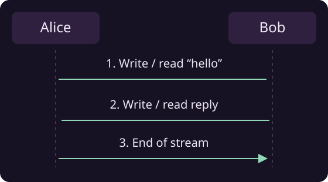

# Simple P2P streams

Connect two Java applications with an `InputStream` and an `OutputStream`. `NostrRTCPeerConnection` handles discovery and the network connection; your code reads and writes ordinary Java streams.



## Set up the project

Use Java 21 or newer and add the library and JVM adapter to your Gradle project:

```groovy
repositories {
    mavenCentral()
    maven { url = uri("https://central.sonatype.com/repository/maven-snapshots/") }
}

dependencies {
    implementation "org.ngengine:nostr4j:0.3.0-SNAPSHOT"
    implementation "org.ngengine:nge-platform-jvm:0.3.0-SNAPSHOT"
}
```

The example initializes the JVM adapter at startup. For mobile apps, use the appropriate [platform adapter](platforms.md).

## Run the example on two peers

Save the code below as `StreamExample.java` in your project's Java sources. Run it in two terminals or on two devices with these program arguments:

| Peer | Arguments |
|---|---|
| Alice | `send my-test-connection` |
| Bob | `reply my-test-connection` |

Each instance prints its public peer ID. Copy Alice's ID into Bob's terminal and Bob's ID into Alice's terminal. Alice sends a greeting, Bob replies, and the connection closes.

```java
--8<-- "site-demos/src/backend/java/StreamExample.java:example"
```

Both peers use the same connection ID and call `connect()` with the other's public key. The simple constructor creates a temporary identity and uses matching default signaling settings.

!!! tip "Connection IDs"
    For your app, generate a unique connection ID for each conversation and share it along with the public peer IDs.

!!! note "Blocking I/O"
    These streams use blocking I/O. Use Java threads to keep reads and writes separate from other work. This console example runs on its main thread.

## Send your own data

The example wraps the streams in `DataInputStream` and `DataOutputStream`. `writeUTF()` and `readUTF()` provide a simple format for short messages, so the receiver knows where each message ends.

These are ordinary Java streams. Use the same techniques and wrappers you would with any other stream, including `BufferedInputStream`, `BufferedOutputStream`, readers and writers.

!!! tip "Close when finished"
    Call `close()` on the output stream when the exchange is finished, then close the connection.

## End-to-end encryption

Stream data is encrypted end to end between the two peers. The receiving peer decrypts it automatically, including when the connection uses a TURN fallback. The TURN server cannot read the stream's contents.

!!! tip "Encryption is built in"
    Read and write normally: Nostr4j handles encryption and decryption. You do not need to add your own encryption layer to protect stream data in transit.

## Reuse an identity

To keep the same public peer ID across sessions, load your saved private key and use this constructor in place of the temporary-identity constructor:

```java
NostrPrivateKey localPrivateKey = NostrPrivateKey.fromBech32(savedNsec);
NostrRTCPeerConnection connection =
    new NostrRTCPeerConnection(localPrivateKey, sharedConnectionId);
```

Use the same connect, read and write steps.

## Choose relays or add a fallback

Use the settings constructor when you need your own signaling relays or a Nostr4j TURN fallback:

```java
RTCSettings settings = RTCSettings.getDefault("my-app", "byte-stream-v3")
    .withSignalingRelays(List.of("wss://relay.ngengine.org"));

String turnUrl = "wss://turn.example.com/turn";
int chunkSize = 4096;
int reusableChunks = 16;

NostrRTCPeerConnection connection = new NostrRTCPeerConnection(
    settings, sharedConnectionId, turnUrl, chunkSize, reusableChunks);
```

Replace the TURN URL with your service, or pass `null` to use only direct connectivity. The simple example above uses direct connectivity. Both peers need matching application and protocol IDs and a common signaling relay. Chunk settings control how bytes are split and buffers reused.

!!! tip "Fallback server"
    Use a [Nostr4j-compatible TURN service](turn-server.md) when direct connections are unavailable.

For rooms, multiple participants and named channels, continue with [How RTC connections work](p2p-overview.md).
