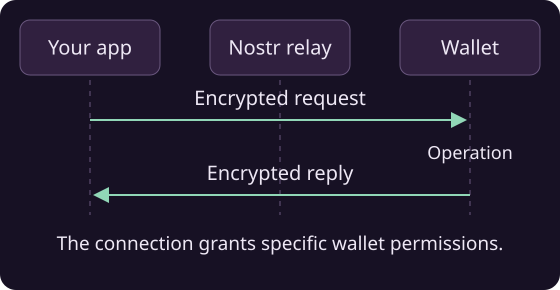

# Connect an NWC wallet

<a class="doc-run-button" href="../demos.html#wallet">Run wallet demo</a>

To read a balance, create an invoice or pay one, ask the user for a Nostr Wallet Connect connection. They create it in their wallet and choose what your app may do. The connection string contains the secret authorizing those operations; you don't need the wallet's account keys.



## Connecting

Pass the `nostr+walletconnect://` URI to `NWCWallet`, with either an existing pool or a new one owned by the wallet:

```java
NWCUri uri = new NWCUri("nostr+walletconnect://...");

NWCWallet wallet = new NWCWallet(pool, uri);
// or: NWCWallet wallet = new NWCWallet(uri);   // own pool

if (!wallet.waitForReady().await()) {
    throw new IllegalStateException("Wallet service is not ready");
}
```

Inspect the connection's relay list, public key and other fields through `NWCUri` if needed; avoid logging the secret.

## Reading state

```java
long balanceMsats = wallet.getBalance(null).await();   // millisats
WalletInfo info = wallet.getInfo(null).await();        // advertised capabilities
List<String> methods = wallet.getSupportedMethods().await();
```

Check `isMethodSupported(...)` before offering an operation in your UI. If you already have a connection and only need its current readiness state, use `isReady()`.

Each connection has its own permissions. Check them again when the user connects with a different permission set, and handle timeouts or failed requests in your UI.

## Let the user pair through a QR code

`NWCAuth` supports wallets that understand `nostr+walletauth://` pairing. Request only the methods the current feature needs; this read-only example asks for a balance and optionally wallet information:

```java
NWCAuth pairing = new NWCAuth(
    List.of("wss://relay.ngengine.org"),
    "My app",
    List.of("get_balance"),
    List.of("get_info"));
try {
    AsyncTask<NWCUri> connection = pairing.awaitConnection(Duration.ofMinutes(2));
    showQr(pairing.getConnectionUri());
    NWCUri authorized = connection.await();
    NWCWallet linkedWallet = new NWCWallet(authorized);
    // Use the connection/readiness flow above; keep linkedWallet until disconnect.
} finally {
    pairing.close();
}
```

## Paying and invoicing

```java
// pay a Lightning invoice
PayResponse res = wallet.payInvoice(bolt11, null, null).await();

// create an invoice on the wallet
InvoiceProperties request = new InvoiceProperties(
    21_000L, "Nostr4J demo", null, Duration.ofMinutes(10));
InvoiceData inv = wallet.makeInvoice(request, null).await();

// spontaneous payment without an invoice
NWCKeysendResponse sent = wallet
    .keySend(null, amountMsats, recipientPubkeyHex, null, null, null)
    .await();

// look things up
InvoiceData seen = wallet.lookupInvoice(paymentHash, null, null).await();
List<TransactionInfo> txs =
    wallet.listTransactions(from, until, 20, 0, false, null, null).await();
```

Amounts are in millisatoshis. The final argument to these request methods is an optional expiry time (`Instant`, or `null` for none). Close the wallet when the connection is no longer needed.

!!! note "Pool ownership"
    With `new NWCWallet(uri)`, closing the wallet also closes its pool. With `new NWCWallet(pool, uri)`, the supplied pool stays open; close it after its other users have finished.
